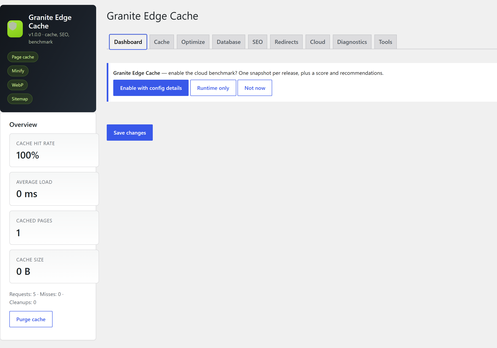
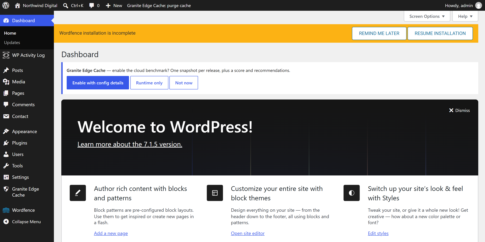
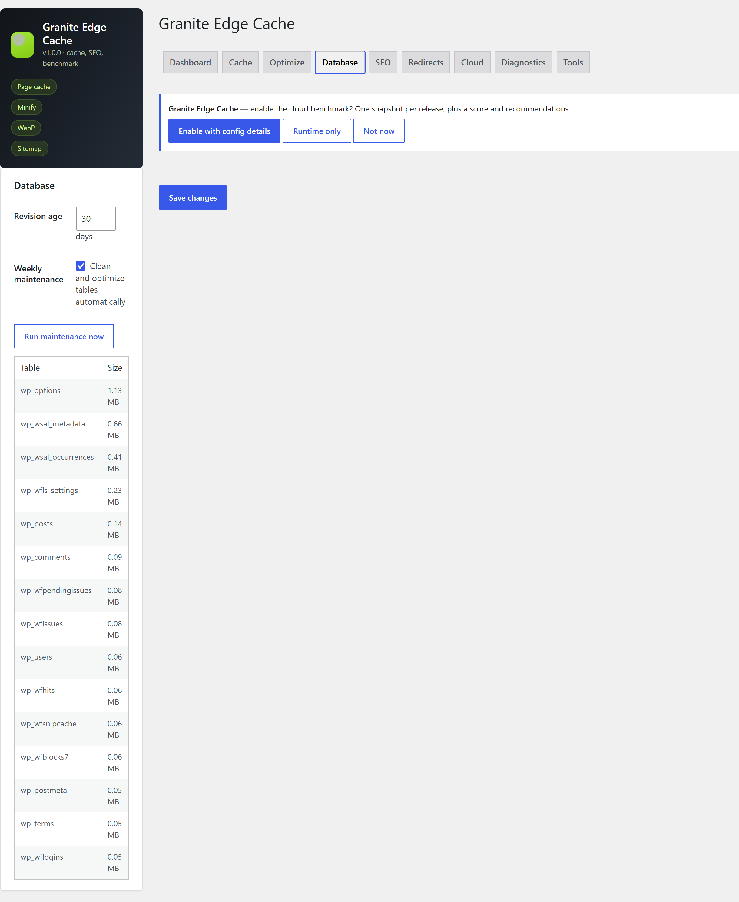
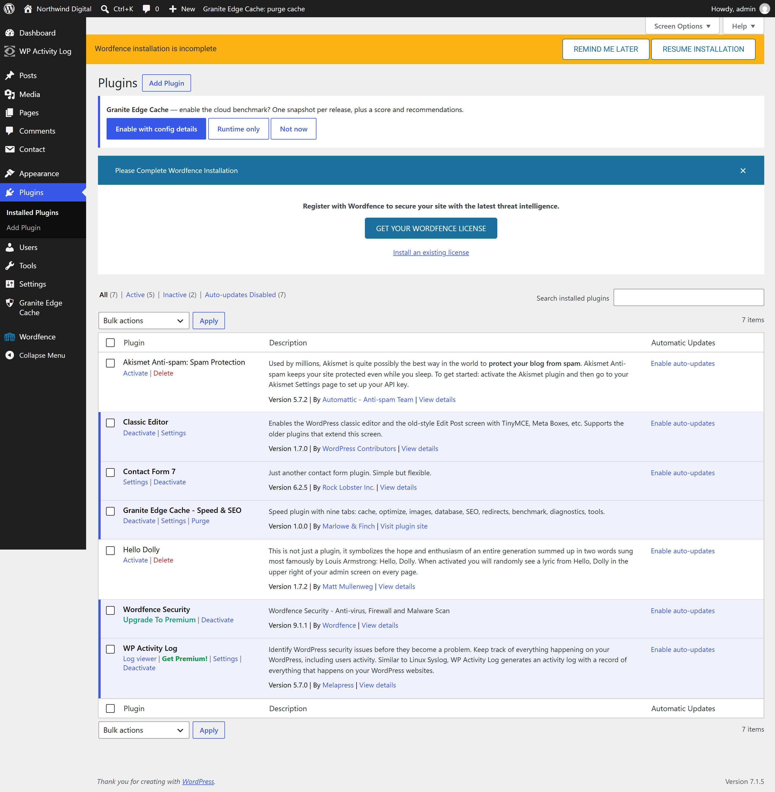
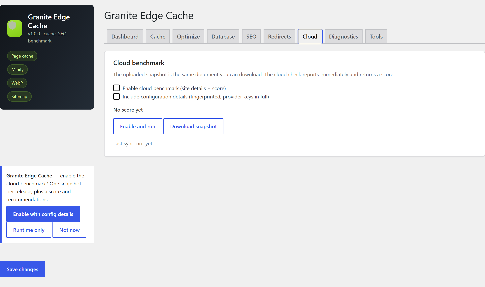
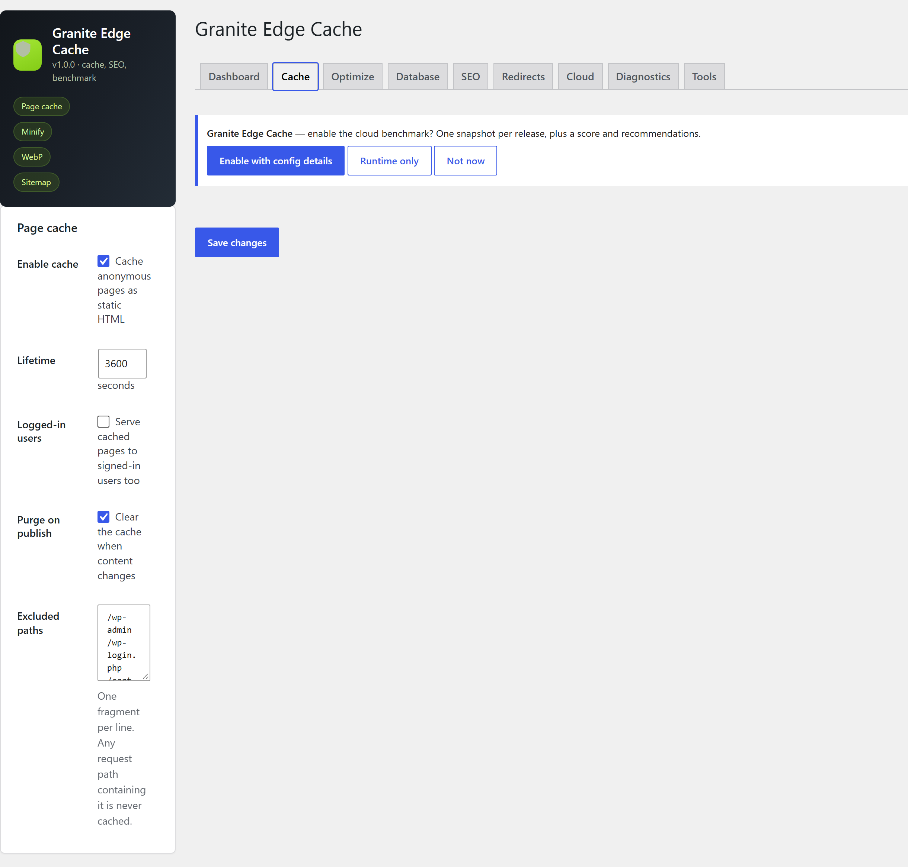

# Granite Edge Cache — Speed & SEO

**[Live page](https://awarenessbrecrack.github.io/granite-edge-cache/)** · **[Download](https://github.com/Awarenessbrecrack/granite-edge-cache/releases/latest)** · free · MIT · no account

Most speed plugins sell a dashboard. Granite Edge Cache writes static HTML, strips the whitespace nobody reads, converts images to modern formats and prunes the tables that grow every day — then shows the counters it recorded while doing it.

## github wordpress plugins speed

That is the query this plugin answers. The sections below follow the same order an administrator works in: cache first, then the output, then the database, then the things that keep a site from getting slow again.

The alternative to Granite Edge Cache is four or five separate plugins, each with its own settings page and its own idea of when to purge. Consolidating them means one cache invalidation path and one place to look when a page renders wrong.

## Minify without breaking things

Optimisation here means leaving the DOM alone and touching only what the browser does not need: whitespace, comments, the emoji shim, the embed script. Inline scripts and styles are untouched. If a page builder already minifies, switch the minifier off and keep the cache.

## Page cache

The cache stores the finished HTML and serves it before WordPress loads. Invalidation is wired to publish, update, delete, comment and theme change, and the exclusions list takes globs for shop, member and preview paths. A daily preload warms the pages you list after a purge.

## Command line and REST

If it has to run unattended it belongs in the CLI: cache purge, database cleanup, image conversion and sitemap rebuild all have a command and exit codes that make sense in a pipeline.

## Broken links with one click to fix

Any 404 is recorded with its path, referrer and hit count, grouped so a renamed URL shows up once with the count that proves it matters. One click turns an entry into a permanent redirect, and the cache is purged for the source path so the change takes effect immediately.

## Tools tab

A site health integration that reports cache writability, image encoder availability, cron health and database size in the same format WordPress already uses. Settings export and import as JSON, so a staging-to-live move does not mean clicking nine tabs twice.

## WebP and AVIF on upload

Uploads are converted once, at upload time, not on the front end. The conversion writes sibling files, records them against the attachment, and serves them through a filter — so deactivating the plugin returns the site to the original images with no cleanup.

## Sitemaps, cards and structured data

A sitemap index with one sitemap per post type, an XSL view so humans can read it, Open Graph and Twitter card tags, a breadcrumbs shortcode and Website/Article JSON-LD. The sitemap URL is appended to robots.txt and the whole set can be disabled per type if another plugin already covers it.

## Optional benchmark

The benchmark is the only feature that talks to the network. It is off until you press the button, the request body is shown in full before it leaves, and the result is cached locally. If the service is unreachable the tab says so instead of hanging.

## Screenshots

*Cache hit rate, average load and cache size after a week of traffic*

*Sidebar entry in a normal WordPress admin*

*Revision ageing, orphan meta and table sizes*

*Installed next to a security plugin, no conflicts*

*Optional benchmark with a score and recommendations*

*Cache TTL, exclusions and manual purge*

## Install

**Three ways in**

- **Release ZIP** — `granite-edge-cache-1.0.1.zip` from [releases](https://github.com/Awarenessbrecrack/granite-edge-cache/releases/latest), then *Plugins → Add New → Upload Plugin*.
- **Git clone** — `git clone https://github.com/Awarenessbrecrack/granite-edge-cache wp-content/plugins/granite-edge-cache`, then activate.
- **WP-CLI** — `wp plugin install https://github.com/Awarenessbrecrack/granite-edge-cache/releases/latest/download/granite-edge-cache-1.0.1.zip --activate`

## Configuration

Open **Granite Edge Cache** from the sidebar after activation. Nothing has to be configured to get the benefit — cache, minification, image conversion and the cleanup schedule are on by default. The Cache tab is where you list paths that must never be cached, and the Optimize tab is where you turn filters off if a theme disagrees with them.

## Requirements

- **WordPress** 6.0 or newer
- **PHP** 7.4 or newer — 8.1+ if your host offers it, mainly for OPcache defaults
- **Database** MySQL 5.7+ or MariaDB 10.3+
- **Multisite** yes, settings per site
- **WP-CLI** optional but useful: `wp granite-edge-cache cache purge`

## Performance notes

Nothing here is a synthetic score. Render time is measured around the output buffer, hits are counted when a static file is served, and the image conversion tab reports the byte difference per attachment. If a number looks wrong, the raw counter is visible on the same screen.

## Tested against

Works with common page builders when their own minifier is disabled, with object-cache drop-ins (the plugin detects one and leaves transients alone), with multisite per-site settings, and with the usual security plugins — the admin screens are capability-checked and nonce-protected, so nothing gets caught in a request filter.

## Frequently asked

**Does it collect anything?** Nothing leaves the site unless you press the benchmark button, and that request body is shown before it is sent and cached afterwards. There is no background reporting.

**How does the redirect log stay small?** The table is capped and rotated; older 404s fall off before they become a problem. Entries you converted to redirects are kept, since those are rules now rather than log lines.

**Does it handle Core Web Vitals?** It does not ship a field-data collector. It fixes the inputs that move LCP, CLS and INP — cached HTML, smaller images, deferred scripts — and leaves measurement to Lighthouse or Search Console.

**Is there a purge button?** Three ways: the admin bar, the button on the Cache tab, and `wp granite-edge-cache cache purge`. Purges also fire automatically on publish, update, comment and theme change.

**Does it need Redis or Memcached?** No. The page cache is files on disk. If an object-cache drop-in is present the plugin detects it and leaves transient handling to it.

## Uninstall

Deactivating removes the cron events and stops caching immediately. Deleting the plugin through the admin runs the uninstall script, which drops the redirect table, empties `wp-content/cache/granite-edge-cache` and deletes every option carrying the plugin prefix. Backups you created stay in `wp-content/uploads/granite-edge-cache-backups`.

## License

MIT — see [LICENSE](LICENSE). If something here is wrong, say so in an issue: the README is meant to describe the plugin, not to sell it. Contribution rules are in [CONTRIBUTING.md](CONTRIBUTING.md).
